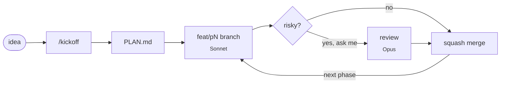

<div align="center">

# 🎛️ vibe-starter

*my current Claude Code setup for new side projects*

<sub>Opus plans · Sonnet builds ☕</sub>

<br>

Mainly used with:


</div>

---

This is a Claude Code setup to copy into new side projects. It grew out of
repeating the same things over and over: write a plan, make a branch, nag the model
to run the tests, commit, merge. Now a few agents, skills and hooks do that part,
and I mostly just read the plan, approve and check git diff.

It's opinionated and tuned for my habits, and it tries hard not to burn tokens. Take what you like :)

## 🔄 How a project goes



1. `/kickoff`: Claude asks me a few questions about the idea and the stack. Then the
   planner (Opus) writes a `PLAN.md` with phases, small milestones and a rough risk rating.
2. `/run-plan`: Opus works through the plan, but it never touches code itself. For each phase:
   - Sonnet makes a `feat/pN-something` branch, does one commit per milestone, runs the
     checks, and pushes as it goes.
   - If a phase looks risky (auth, migrations, a big diff), Claude asks me whether Opus
     should review it. Otherwise it just merges.
   - The branch gets squash-merged into `main`, then on to the next phase.
3. A Stop hook keeps the loop going until the plan is done. It stops if something is
   `BLOCKED:` or if nothing moved since the last nudge.

When I want to cut in, I write `BLOCKED: <reason>` in `PLAN.md` and Claude stops and waits.

## 🧰 What's in the box

```
.claude/
  agents/
    planner.md         Opus, writes PLAN.md
    implementer.md     Sonnet, builds one phase on its branch
    code-reviewer.md   Opus, reviews a branch diff (only when I say yes)
  skills/
    kickoff/           questions, stack choice, plugins, hand-off to the planner
    run-plan/          the phase loop: implement, maybe review, merge
    repo-man/          Aider's repo map, so Claude knows where things live before it reads
    build-check/       finds Go / Node / PHP projects and runs their checks quietly
  hooks/
    guard.sh           blocks force pushes, reset --hard, deleting main, rm -rf on silly paths
    stop-continue.sh   the autopilot
    format.sh          formats each edited file with the project's own formatter
    check-tools.sh     complains at session start if aider or jq is missing
  statusline.sh        model | branch | context % | cost | 5h limit
  settings.json        plugins, permissions, hooks
CLAUDE.md              the short rulebook every agent reads
scripts/bootstrap.sh   installs the tools and copies all of this into a new project
```

## 🧩 Stacks

I mostly work in Go, TypeScript (Vue or React) and PHP (mostly Symfony), so that's what it understands:

| Stack | Checks | Formatter | Language server |
|---|---|---|---|
| Go | `go vet`, `go build`, `go test` | `goimports` or `gofmt` | gopls |
| TypeScript / Vue / React | the `typecheck` (or `build`), `lint` and `test` scripts | local `prettier` | typescript-language-server |
| PHP / Symfony | `phpstan`, `phpunit`, `lint:container` | `php-cs-fixer` | intelephense |

For anything else, put a `scripts/check.sh` in the project and the build check runs that instead.

`/kickoff` turns on the matching language server plugin. It also turns on Playwright
when there's a browser UI. Context7, for up-to-date library docs, is always on.

## 🪶 Being stingy with tokens

Most of the design comes down to this:

- Opus only ever sees `PLAN.md` and a five-line report per phase, never the code.
- Each phase starts Sonnet with a fresh context instead of one ever-growing chat.
- The repo map comes before any file reads, and only the files it points to get opened.
- Checks print `BUILD OK` or the failure, nothing else.
- Formatting happens in a hook, so nobody spends tokens on whitespace.
- [caveman](https://github.com/JuliusBrussee/caveman) keeps the answers short.

## 🚀 Getting started

```bash
git clone https://github.com/YOUR_USER/vibe-starter.git
vibe-starter/scripts/bootstrap.sh ~/dev/my-new-thing
cd ~/dev/my-new-thing && claude
```

Then `/kickoff` and later `/run-plan`. Restart Claude once after `/kickoff`, so any new plugins load.

The bootstrap script needs `git`, `jq` and [uv](https://docs.astral.sh/uv/), which it uses to install [Aider](https://aider.chat).
It also adds the caveman plugin. It tells you about anything else that's missing,
like language servers, and never overwrites files that already exist.

<details>
<summary>What a PLAN.md looks like</summary>

```markdown
# Plan: tiny-links
autopilot: on

## Phase 1: Core shortener
Branch: feat/p1-core
Goal: Shorten a URL and redirect to it.
Done when: POST /links returns a code; GET /<code> redirects with 302; tests pass.
Risk: low
Status: merged
- [x] M1.1 Link model and in-memory store
- [x] M1.2 POST /links handler with validation
- [x] M1.3 GET /<code> redirect handler

## Phase 2: Accounts
Branch: feat/p2-accounts
Goal: Users own their links.
Done when: signup, login and per-user link list work; passwords hashed.
Risk: high (auth)
Status: in-progress
- [x] M2.1 User model and password hashing
- [ ] M2.2 Signup and login endpoints
- [ ] M2.3 Link ownership and listing
```

</details>

## 🙏 Thanks

To [caveman](https://github.com/JuliusBrussee/caveman) by Julius Brussee, [Aider Repo-Map](https://aider.chat/docs/repomap.html)
for the repo map, and [Context7](https://context7.com) and [Playwright](https://playwright.dev)
for the plugins.
